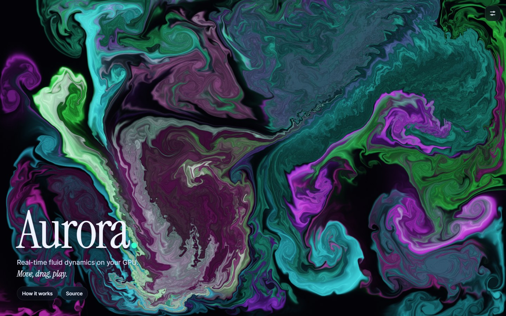

<div align="center">

# Aurora

**Real-time fluid dynamics in the browser, solved on the GPU with raw WebGL2.**
No libraries, no build step, and under 1,000 lines of JavaScript and GLSL.

[**▶ Open the live demo**](https://chop-prog.github.io/aurora/)



</div>

## What it is

Aurora is an interactive simulation of an incompressible fluid. Move the mouse (or drag a finger) to stir it, and coloured dye is carried along by the flow, curling into vortices. Every frame, the Navier–Stokes equations are solved on the GPU with Jos Stam's *Stable Fluids* method.

## Features

- **GPU solver.** A chain of fragment-shader passes writes into half-float textures every frame.
- **Vorticity confinement** keeps the small, lively swirls that numerical diffusion would otherwise smear away.
- **Debug views of the solver** (keys `1–4`) show the dye, velocity, pressure and vorticity fields.
- **Presets** (Calm, Storm, Ink, Inferno) plus live sliders for swirl, viscosity, fade, brush size and pressure iterations.
- **Shareable state.** The settings are encoded in the URL hash, so *Share* copies a link that reproduces your exact setup.
- **Microphone mode.** Bass hits trigger splashes, and the spectral centroid picks the colour.
- **Autopilot.** When nobody is touching it, two invisible brushes trace Lissajous curves so the page is never static.
- **Adaptive quality.** The dye resolution halves automatically if the GPU can't keep up.
- **Snapshot** to PNG, multi-touch support, keyboard shortcuts, accessible form controls, and `prefers-reduced-motion` support.

## The pipeline

| # | Pass | Purpose |
|---|---|---|
| 1 | Curl | measure local rotation ω = ∇×u |
| 2 | Vorticity | add confinement force ε(N×ω) |
| 3 | Divergence | ∇·u: where the flow is compressing |
| 4 | Pressure ×N | Jacobi iterations for ∇²p = ∇·u |
| 5 | Projection | u ← u − ∇p, making the flow divergence-free |
| 6 | Advection | semi-Lagrangian back-trace of velocity and dye |
| 7 | Display | tone mapping, normal-based shading, dithering |

All of this lives in [`src/shaders.js`](src/shaders.js), while [`src/fluid.js`](src/fluid.js) manages framebuffers, ping-pong double buffering, render-target format detection (`RG16F`/`R16F` with an `RGBA16F` fallback) and resizing that preserves the current fluid state.

## Code tour

```
src/
  fluid.js     WebGL2 solver: programs, FBOs, step(), splat(), render()
  shaders.js   GLSL ES 3.00 for every pass
  main.js      input, autopilot, mic analysis, UI wiring, adaptive quality
  config.js    defaults, presets, validation, URL encoding   (pure, tested)
  color.js     HSV → RGB, palettes                           (pure, tested)
tests/         node:test suites
```

## Run locally

```bash
npm start   # http://localhost:5173  (on Windows you can also double-click start.bat)
npm test
```

Requires a browser with WebGL2 and float render targets: every current desktop and mobile browser qualifies.

## License

[MIT](LICENSE)
